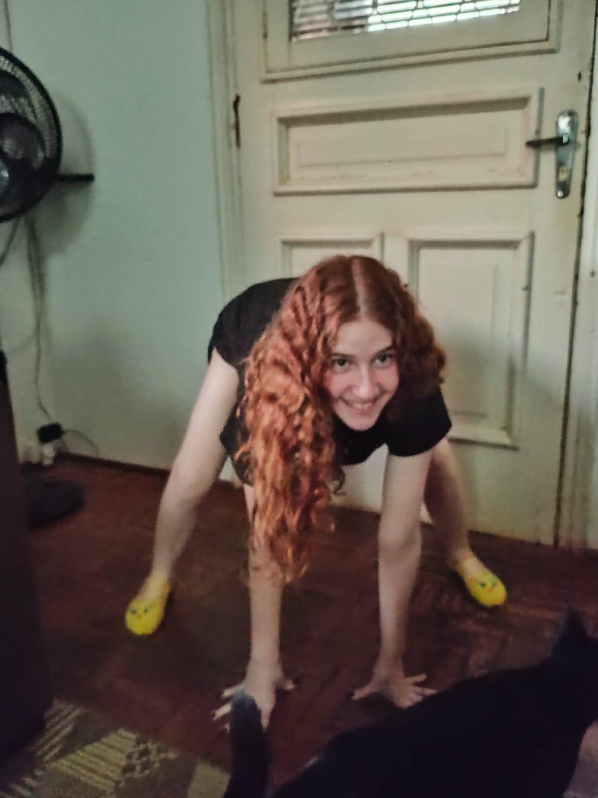
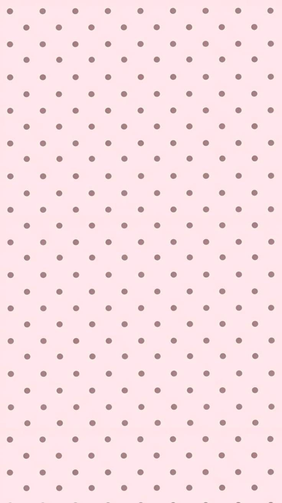

<!DOCTYPE html>
<html lang="pt-br">
<head>
    <meta charset="UTF-8">
    <meta name="viewport" content="width=device-width, initial-scale=1.0">
    <title>ANIVERSARIO DA MIA MOMOLADADADADA - QUIZ</title>
</head>

<body class="body">
    
    
    
    

        <h1>QUIZ SOBRE EU E MIA MOMOLADAAAAAAA</h1>
    

    

        <section>
            <h3 class="pergunta1">Quando foi o dia da nossa primeira trocas de mensagens no Whatssap?</h3>
            <label class="input">
                <input type="radio" id="resposta_certa1" name="pergunta1" class="desativado">18/02/24
                <input type="radio" id="resposta_errada1" name="pergunta1" class="desativado">02/03/24
                <input type="radio" id="resposta_errada1" name="pergunta1" class="desativado">20/02/24
                <input type="radio" id="resposta_errada1" name="pergunta1" class="desativado">15/02/24
                

            </label>    
        </section>
        <section>
            <button id="botãoP1">Confirmar</button>
        </section>
    

    

        <section>
            <h3 class="pergunta2">Quando que foi o dia que a gente se casou?</h3>
            <label class="input">
                <input type="radio" id="resposta_errada2" name="pergunta2" class="desativado">19/04/26
                <input type="radio" id="resposta_errada2" name="pergunta2" class="desativado">23/04/26
                <input type="radio" id="resposta_certa2" name="pergunta2" class="desativado">21/04/26
                <input type="radio" id="resposta_errada2" name="pergunta2" class="desativado">20/04/26
                

            </label>    
        </section>
        <section>
            <button id="botãoP2">Confirmar</button>
        </section>
    

    

        <section>
            <h3 class="pergunta3" >Quantas rosas tem no buque que eu te dei?</h3>
            <label class="input">
                <input type="radio" id="resposta_errada3" name="pergunta3" class="desativado"> 5
                <input type="radio" id="resposta_certa3" name="pergunta3" class="desativado"> 7
                <input type="radio" id="resposta_errada3" name="pergunta3" class="desativado"> 6
                <input type="radio" id="resposta_errada3" name="pergunta3" class="desativado"> 8
                

            </label>  
        </section>
        <section>
            <button id="botãoP3">Confirmar</button>
        </section>
    

    

        <section>
            <h3 class="pergunta4" >Qual manga eu te dei ano passado?</h3>
            <label class="input">
                <input type="radio" id="resposta_certa4" name="pergunta4" class="desativado"> Hanako volume 4
                <input type="radio" id="resposta_errada4" name="pergunta4" class="desativado"> Hanako volume 3
                <input type="radio" id="resposta_errada4" name="pergunta4" class="desativado"> Hanako volume 5
                <input type="radio" id="resposta_errada4" name="pergunta4" class="desativado"> Jujutsu Kaisen volume 67
                

            </label>    
        </section>
        <section>
            <button id="botãoP4">Confirmar</button>
        </section>
    

    

        <section>
            <h3 class="pergunta5">Qual foi o dia em que a gente saiu junto pela primeira vez?</h3>
            <label class="input">
                <input type="radio" id="resposta_errada5" name="pergunta5" class="desativado"> 15/04/26
                <input type="radio" id="resposta_errada5" name="pergunta5" class="desativado"> 18/04/26
                <input type="radio" id="resposta_errada5" name="pergunta5" class="desativado"> 20/04/26
                <input type="radio" id="resposta_certa5" name="pergunta5" class="desativado"> 19/04/26
                

            </label>    
        </section>
        <section>
            <button id="botãoP5">Confirmar</button>
        </section>
    

    

        <section>
            <h3 class="pergunta6">Qual foi o manga que eu te dei de dia dos namorados?</h3>
            <label class="input">
                <input type="radio" id="resposta_errada6" name="pergunta6" class="desativado"> Konosuba
                <input type="radio" id="resposta_errada6" name="pergunta6" class="desativado"> Hanako
                <input type="radio" id="resposta_certa6" name="pergunta6" class="desativado"> Frieren
                <input type="radio" id="resposta_errada6" name="pergunta6" class="desativado"> Solo leveling aura 67 42
                

            </label>    
        </section>
        <section>
            <button id="botãoP6">Confirmar</button>
        </section>
    

    

        <section>
            <h3 class="pergunta7">Porque eu fiz um quiz?</h3>
            <label class="input">
                <input type="radio" id="resposta_errada7" name="pergunta7" class="desativado"> Porque sou preguiçoso
                <input type="radio" id="resposta_errada7" name="pergunta7" class="desativado"> Porque achei que voce iria gostar
                <input type="radio" id="resposta_certa7" name="pergunta7" class="desativado"> Porque isso nos traz lembranças
                <input type="radio" id="resposta_certa7" name="pergunta7" class="desativado"> Porque sim
                

            </label>    
        </section>
        <section>
            <button id="botãoP7">Confirmar</button>
        </section>
    

    

        <section>
            <h3 class="pergunta8"> Está faltando pergunta sua ne? Você gostaria se eu começasse a berrar do nada em publico para todo mundo ouvir.</h3>
            <label class="input">
                <input type="radio" id="resposta_certa8" name="pergunta8" class="desativado"> Sim
                <input type="radio" id="resposta_errada8" name="pergunta8" class="desativado"> Depende
                <input type="radio" id="resposta_errada8" name="pergunta8" class="desativado"> Apenas não
                <input type="radio" id="resposta_errada8" name="pergunta8" class="desativado"> Nunca
            

            </label>
        </section>
        <section>
            <button id="botãoP8">Confirmar</button>
        </section>
    

    

        <section>
            <h3 class="pergunta9">Quando normalmente você se assusta ou leva uma surpresa, você faz um gesto, qual?</h3>
            <label class="input">
                <input type="radio" id="resposta_errada9" name="pergunta9" class="desativado"> Pular
                <input type="radio" id="resposta_errada9" name="pergunta9" class="desativado"> Se cobrir
                <input type="radio" id="resposta_errada9" name="pergunta9" class="desativado"> Dançar?
                <input type="radio" id="resposta_certa9" name="pergunta9" class="desativado"> Segurar os peitos
                

            </label>    
        </section>
        <section>
            <button id="botãoP9">Confirmar</button>
        </section>
    

    

        <section>
            <h3 class="pergunta10">Oque eu mais amo em você?</h3>
            <label class="input">
                <input type="radio" id="resposta_certa10" name="pergunta10" class="desativado">Seus olhos, que parecem um horizonte de um mar aberto cheio de novas aventuras e sentimentos
                 
                <input type="radio" id="resposta_certa10" name="pergunta10" class="desativado">Seu cabelo enrolado, mostrando um ciclo de beleza onde se enrola mostrando uma bela cor ruiva
                 
                <input type="radio" id="resposta_certa10" name="pergunta10" class="desativado">Seu rosto, onde cada curva forma uma nova figura onde jamais podera ser reproduzida por tal beleza e divindade
                 
                <input type="radio" id="resposta_certa10" name="pergunta10" class="desativado">Sua personalidade, onde quando converso com você consigo criar novos mundos imaginarios com cada um ao seu lado por conseguir uma unica pessoa expressar e me dar novos sentimentos onde jamais serão esquecidos
                 
                

            </label>    
        </section>
        <section>
            <button id="botãoP10">Confirmar</button>
        </section>
    

    

         
        

        <button id="BotãoF">Ver resultado</button>
    

</body>

</html>
